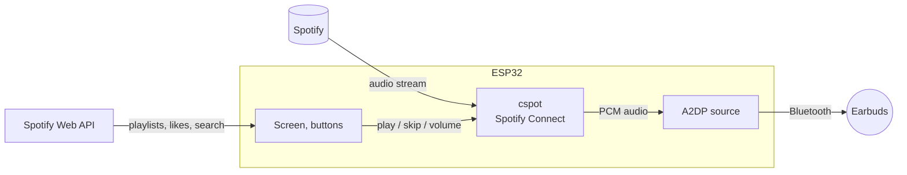

# EVA-01

A pocket Spotify player built on an ESP32. It streams music over Wi-Fi with no
phone involved and plays it through Bluetooth earbuds.

> **Status: early.** The wiring and interface run in a browser simulator with
> sample data. Spotify streaming and Bluetooth audio come next, on real hardware.

- [Try it in the simulator](#try-it-in-the-simulator)
- [How it works](#how-it-works)
- [What it can do](#what-it-can-do)
- [Hardware](#hardware)
- [Wiring](#wiring)
- [Controls](#controls)
- [Project layout](#project-layout)
- [Roadmap](#roadmap)
- [Caveats](#caveats)

## Try it in the simulator

You don't need any hardware. [`sim/sketch/`](sim/sketch) is a
[Wokwi](https://wokwi.com) project with the full wiring below already done.
Wokwi can't simulate Bluetooth audio or Spotify, so the songs are sample data
and playback runs on a timer.

1. Open <https://wokwi.com/projects/new/esp32>.
2. Replace `sketch.ino` and `diagram.json` with the files from `sim/sketch/`.
3. Add a `libraries.txt` file with the same contents as the one in `sim/sketch/`.
4. Press play.

The screen shows `EVA-01` in the status bar once it boots, and the Serial
Monitor prints each play, pause and like.

## How it works



Two pieces do the work:

- **[cspot](https://github.com/feelfreelinux/cspot)** turns the ESP32 into a
  Spotify Connect device. It shows up in Spotify's device list like a smart
  speaker does, and pulls audio straight from Spotify's servers.
- **The Spotify Web API** handles browsing: your playlists, Liked Songs, search,
  the queue, and liking the current song. It can also start playback *on the
  ESP32 itself*, so after a one-time login you don't need the phone.

The decoded audio goes out to the earbuds over Bluetooth Classic (A2DP).

## What it can do

| Works | Doesn't |
|---|---|
| Play, pause, skip, seek, volume, shuffle, repeat | Jam |
| Your playlists: play, create, edit | AI DJ, Smart Shuffle, Blend, daylist |
| Liked Songs: play, like, unlike | Lyrics |
| Queue, search, recently played | Offline downloads |
| Album art on the screen | Listing Spotify-made playlists (Discover Weekly, Daily Mix) |

Spotify only offers the features in the right-hand column inside its own apps.

## Hardware

| Part | Notes |
|---|---|
| ESP32 dev board | Must be an original ESP32. The S3, C3 and C6 have no Bluetooth Classic, so they can't send audio to earbuds. Spotify streaming needs a **WROVER** module (with PSRAM). |
| ILI9341 TFT, 2.4" or 2.8" | SPI, 240 × 320 |
| 7 tactile buttons | Up, down, select, previous, play/pause, next, like |
| Bluetooth earbuds | Any A2DP earbuds work. Developed against Realme Buds. |
| Spotify Premium | Spotify Connect playback requires it |

<details>
<summary>Does my board have PSRAM?</summary>

Look at the metal shield on the module: **ESP32-WROVER** has PSRAM, while
**ESP32-WROOM-32** almost never does. Or flash this and open the Serial Monitor
at 115200 baud:

```cpp
void setup() {
  Serial.begin(115200);
  delay(1000);
  Serial.printf("Chip: %s rev %d\n", ESP.getChipModel(), ESP.getChipRevision());
  Serial.printf("PSRAM: %u bytes\n", ESP.getPsramSize());
}
void loop() {}
```

`PSRAM: 0 bytes` means the board has none.
</details>

## Wiring

| Part | Pin | ESP32 GPIO |
|---|---|---|
| TFT | VCC, LED | 3V3 |
| | GND | GND |
| | CS | 5 |
| | RST | 33 |
| | D/C | 27 |
| | MOSI | 23 |
| | SCK | 18 |
| | MISO | 19 |
| Buttons | UP | 32 |
| | DOWN | 25 |
| | SELECT | 26 |
| | PREV | 4 |
| | PLAY | 13 |
| | NEXT | 14 |
| | LIKE | 22 |

Each button's other leg goes to GND. The firmware uses the internal pull-ups.

The pins avoid GPIO 6–11 (flash), 16/17 (PSRAM on WROVER), 12 (boot strapping)
and 34–39 (input-only, no pull-ups), so the same wiring works on WROOM and WROVER.

## Controls

The buttons sit in a cross with PLAY in the middle:

```
           [ UP ]
[ PREV ]  [ PLAY ]  [ NEXT ]       [ SELECT ]
          [ DOWN ]                 [  LIKE  ]
```

| Button | Lists | Now Playing |
|---|---|---|
| UP, DOWN | Move through the list (hold to scroll) | Volume up / down |
| SELECT | Open, play, or go back | Back to library |
| PLAY | Play / pause | Play / pause |
| PREV, NEXT | Previous / next track | Previous / next track |
| LIKE | Like the current track | Like the current track |

PREV restarts the current song if it is more than 3 seconds in, the same way
Spotify does.

## Project layout

```
sim/sketch/
├── sketch.ino      UI, input handling and fake playback
├── diagram.json    Wokwi wiring for the board, screen and buttons
└── libraries.txt   Arduino libraries Wokwi installs (Adafruit GFX, ILI9341)
```

## Roadmap

- [x] Wiring and interface in the simulator
- [ ] Confirm the board has PSRAM
- [ ] Bluetooth audio to the earbuds: a test tone first, then MP3s from an SD card
- [ ] Spotify Connect playback with cspot
- [ ] Web API: playlists, Liked Songs, the like button
- [ ] Album art on the screen
- [ ] Battery and enclosure

## Caveats

- cspot is an unofficial, reverse-engineered client. A change on Spotify's side
  can break it until the project catches up. This is a personal project, not a
  product.
- Wi-Fi and Bluetooth share the ESP32's single 2.4 GHz radio. Streaming in and
  sending to the earbuds at the same time takes careful buffering to avoid
  dropouts.
